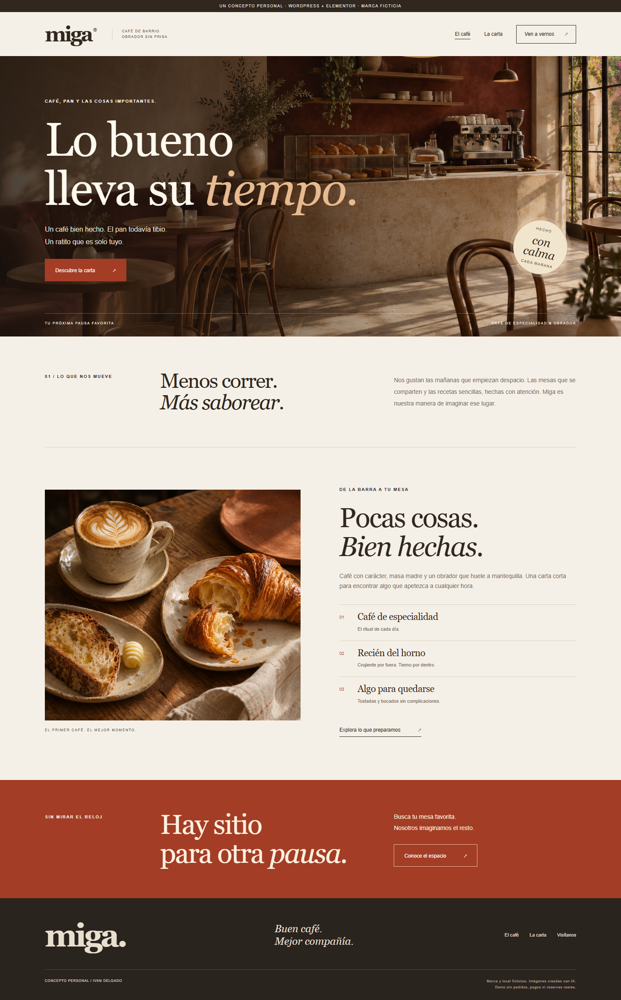

# Miga — a three-page WordPress café concept

A personal WordPress / Elementor project by **Ivan Delgado**, created with AI assistance. Miga is a fictional café. Its menu, prices, opening hours and images are demonstration content, not an operating business.

[](https://github.com/ivaaandeelgado/freelance-wordpress-cafe-demo/actions/workflows/checks.yml)



## What works

- Three actual WordPress pages: home, menu and visit, with native editable Elementor sections.
- A 13-item menu with combined category, accent-insensitive search and maximum-price filters.
- Result counts, empty states, reset controls and accessible pressed states on category buttons.
- A local visit preview with date checks and time options that respect the concept's weekend hours.
- Responsive layouts, keyboard-accessible links, original styling and two original AI-generated images.

The visit form is a browser-only preview. It does not make a reservation, send email or store personal data.

## Run locally

Requires **Node.js 24**, npm and internet access for the first WordPress / Elementor download.

```sh
npm ci
npm start
# Wait for "Miga WordPress demo ready", then open http://127.0.0.1:9418
```

On Windows PowerShell use `npm.cmd` if needed. The start script builds the blueprint automatically. The server binds to loopback; Ctrl+C stops it. Restarting recreates the disposable site.

Open `/wp-admin/` with the **synthetic local** account `admin` / `local-demo-only`. Select a page under **Pages → Edit with Elementor**. Export changes made only in the editor before restarting.

## Try the interactions

1. Open **Carta**, search for `limon`, then lower the maximum price to see an empty result.
2. Clear filters, choose **Café** and set a maximum of `2.50`.
3. On **Visítanos**, choose a Saturday: afternoon options outside the displayed hours become unavailable.
4. Complete the fictional visit preview and check the explicit simulation message.

[Filtered menu](docs/screenshots/menu-filtered.png) · [Menu page](docs/screenshots/menu-desktop.png) · [Mobile home](docs/screenshots/home-mobile.png)

## Tests and reproducibility

With Google Chrome installed and any manually started demo server stopped:

```sh
npm test
```

Seven Playwright checks cover real Elementor content, navigation, image loading, filters, literal search text, visit validation, weekend hours and responsive layouts. Tests start their own runtime and write ignored screenshots/results to `evidence/`. CI uses Chromium on standard Ubuntu runners. The [verification summary](docs/verification.json) records the local run.

| File | Responsibility |
| --- | --- |
| `build-blueprint.mjs` | Pages, Elementor widgets and reproducible setup |
| `demo.js` | Combined menu filters and visit preview |
| `demo.css` | Shared desktop/mobile presentation |
| `assets/` | Original generated images and their provenance |
| `serve.mjs` | Loopback-only WordPress Playground |
| `tests/` | Interaction, content and layout checks |

`npm run build` creates three Elementor templates under `artifacts/templates/` and the companion plugin under `artifacts/miga-demo/`. To import elsewhere, install Elementor and the plugin, create the three pages, and replace the `@@CARTA@@` / `@@VISIT@@` link placeholders. For a subdirectory WordPress installation, update the image URLs or reselect Media Library images. The local blueprint does this setup for its own runtime.

## Scope and assets

This demonstrates a small editable business website and focused improvements to an existing menu or form. It includes no real bookings, payments, analytics, production hosting or claimed client work. Mobile and tablet checks use viewport emulation.

Original code is **GPL-2.0-or-later**; see [LICENSE](LICENSE). Dependency licenses remain with their packages. [Image provenance](assets/image-prompts.json) records the original prompts; the pictures depict a fictional space and meal.
